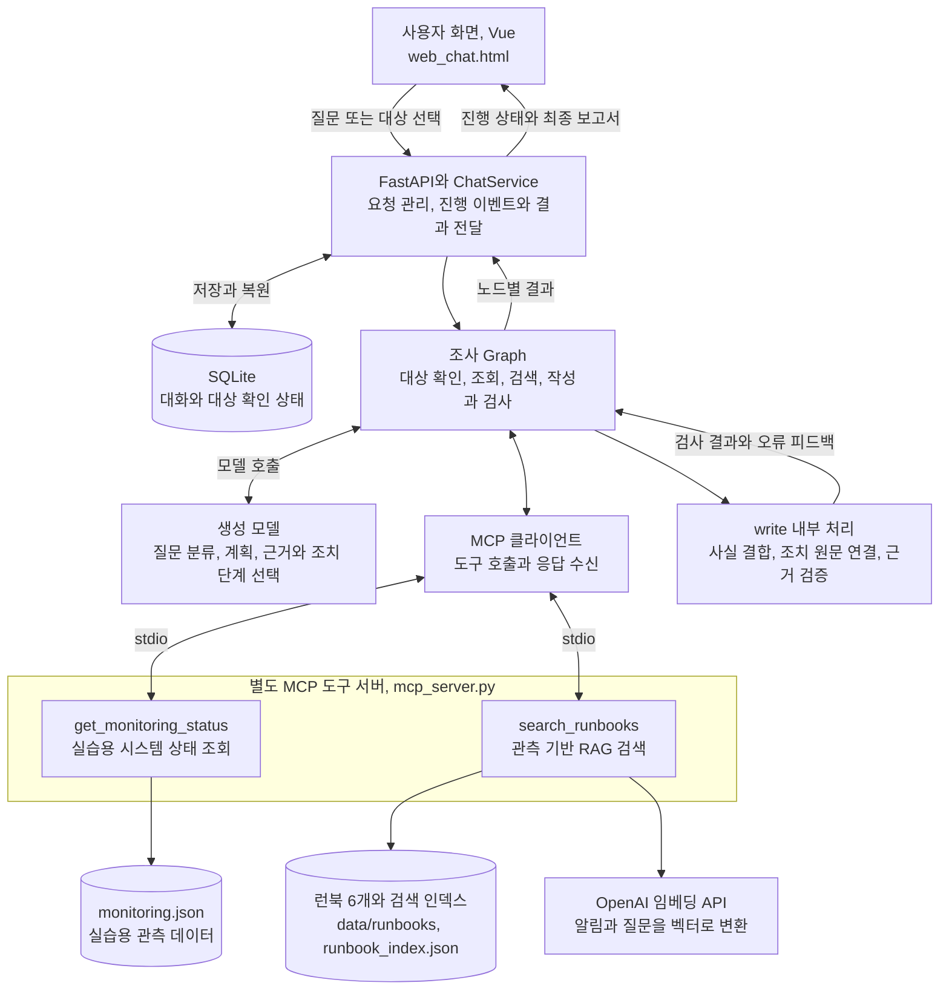

# 장애 대응 Agent

과제 1의 베이스 코드를 확장한 장애 대응 서비스다. 질문에 따라 조사 대상을 확인하고, 시스템 상태에 맞는 대응 문서를 찾아 근거와 조치를 안내한다.

모니터링은 실습용 데이터이며 복구 명령은 실행하지 않는다. 기본 생성 모델은 GPT-4o mini, 검색 임베딩은 text-embedding-3-small을 사용한다.

## 프로젝트 소개

사용자가 “로그인이 느려요”처럼 장애 상황을 입력하면 조사할 서비스를 확인하고, 모니터링 상태와 런북을 조회해 대응 보고서를 만든다. 런북은 장애 대응 절차를 정리한 문서다. 보고서는 확인한 사실, 원인 후보, 권장 조치와 출처를 구분해 보여 준다.

제공된 베이스의 FastAPI, Vue, MCP 연결과 모델 어댑터를 활용했다. 개선의 초점은 현재 장애에 맞는 문서를 찾고, 답변의 측정값과 조치 조건을 원문과 일치시키는 데 있다.

## 주요 개선 기능

| 기능 | 내용 |
|---|---|
| 관측 기반 문서 검색 | 활성 알림에 적용 가능한 런북을 추리고 임베딩으로 관련 문서를 검색 |
| 근거 연결 보고서 | 확인된 사실, 원인 후보, 조치와 출처를 구분 |
| 검증과 재작성 | 측정값, 대상, 출처와 조치 원문을 검사하고 총 3회 이내에서 작성 |
| 진행 상태 표시 | 조사 단계와 대상별 결과, 문서 근거를 화면에 표시 |
| 개선 전후 평가 | 같은 질문과 조건의 원본, 개선 후 결과를 비교해 보고서에 정리 |
| 조사 대상 확인 | 대상이 모호하면 사용자 선택을 받은 뒤 원래 질문으로 조사 |
| 부분 실패 처리 | 일부 조회가 실패해도 확보한 결과와 실패 범위를 함께 안내 |

## 전체 아키텍처

사용자 화면에서 질문을 보내면 FastAPI가 요청을 받고, 조사 Graph가 필요한 도구와 모델을 호출한다. MCP는 도구 서버와의 연결을 담당하고, RAG는 현재 상태에 맞는 대응 문서를 찾는다.



- **기존 구조 활용:** FastAPI, Vue, MCP stdio 연결, 모델 어댑터와 SQLite.
- **개선한 처리:** 대상 확인, 관측 기반 검색, 조치 원문 연결, 검증 후 재작성과 부분 실패 대응.
- 런북 검색은 `mcp_server.py`에서 수행한다. 함께 포함된 `mcp_server_docs.py`는 원본의 문서 예제 서버로, 위 장애 검색 경로에서는 사용하지 않는다.
- 정상 상태나 적용 가능한 문서가 없는 경우 임베딩 검색을 생략할 수 있다. 실제 복구 명령은 실행하지 않는다.

세부 분기와 재작성 조건은 [Graph 처리 흐름](docs/ARCHITECTURE.md#graph-분기와-재작성)을 참고한다.

## 폴더 구조

아래는 주요 파일과 폴더다. 명령은 `README.md`와 `server.py`가 있는 프로젝트 최상위 폴더에서 실행한다.

```text
.
├── README.md                    # 프로젝트 소개와 실행 방법
├── server.py                    # FastAPI 요청 처리, 시작과 종료
├── web_chat.html                # Vue 기반 대화 화면
├── run.ps1                      # Windows 실행 스크립트
├── mcp_server.py                # 모니터링 조회와 런북 검색 도구
├── mcp_server_docs.py           # 원본의 문서 예제 MCP 서버
├── agent/
│   ├── graph.py                # 대상 확인, 조사, 검색, 작성과 검증 흐름
│   ├── service.py              # 대화 요청과 중복 실행 관리
│   ├── targets.py              # 조사 대상 이름 해석과 확인
│   ├── mcp_client.py           # MCP 서버 연결과 도구 호출
│   ├── action_catalog.py       # 선택한 조치 단계의 원문 연결
│   ├── reporting.py            # 사실과 보고서 구성
│   ├── validation.py           # 값, 대상, 출처와 조치 검사
│   ├── schemas.py              # 요청과 결과의 데이터 형식
│   ├── deps.py                 # 모델, MCP 등 공통 의존성
│   ├── session_store.py        # SQLite 대화와 대상 확인 상태 저장
│   └── nodes/investigation.py  # 대상별 작업, 시간 제한과 재시도
├── retrieval/
│   ├── index.py                # 임베딩 인덱스 생성과 검색
│   └── applicability.py        # 알림에 맞는 문서 후보 필터
├── data/
│   ├── monitoring.json         # 실습용 시스템 상태
│   ├── runbooks/               # 장애 대응 문서 6개
│   └── runbook_index.json      # 미리 생성한 검색 인덱스
├── tests/                      # 기능과 회귀 테스트
├── docs/                       # 구조, 수정 사례, 결과보고서와 PPT
├── requirements.txt            # 주요 의존성
├── requirements-lock-windows.txt # 검증 환경의 고정 의존성
└── .env.example                # 비밀값 없는 환경변수 예시
```

## 처리 흐름과 코드 읽는 순서

1. `server.py`와 `agent/service.py`에서 요청을 받고 대화별 실행을 관리한다.
2. `agent/graph.py`에서 일반 대화와 장애 조사를 나누고 조사 대상을 확인한다.
3. `mcp_server.py`의 도구로 상태를 조회하고, `retrieval/index.py`에서 관련 런북을 찾는다.
4. 모델이 근거와 조치 단계 ID를 선택하면 `agent/action_catalog.py`가 조치 원문을 연결한다.
5. `agent/validation.py`가 결과를 검사한다. 실패하면 재작성하고, 끝내 통과하지 못하면 확인된 사실만 표시한다.
6. `web_chat.html`에서 진행 상태와 최종 보고서를 확인한다.

화면은 Vue, API는 FastAPI, 처리 흐름은 LangGraph로 구성했다. MCP는 도구를 연결하고, RAG는 검색한 문서를 답변 근거로 제공한다. 원본의 문서 예제 MCP 서버도 포함되어 있지만 장애 런북 검색은 `mcp_server.py`에서 수행한다.

## 실행

Windows와 Python 3.11.9 기준이다. Python 3.11을 설치하고 `py -3.11 --version`으로 확인한다. Python Launcher가 없으면 아래 `py -3.11` 대신 설치한 Python 3.11 실행 파일의 경로를 사용한다.

```powershell
py -3.11 -m venv .venv
.\.venv\Scripts\python.exe -m pip install -r requirements-lock-windows.txt
Copy-Item .env.example .env
notepad .env
powershell -ExecutionPolicy Bypass -File .\run.ps1 -Backend openai -Port 8109
```

`.env`에 `OPENAI_API_KEY`를 설정한 뒤 http://127.0.0.1:8109/ 에 접속한다. 환경변수는 `.env`보다 우선한다. Vue CDN과 OpenAI API 사용을 위해 인터넷 연결이 필요하다. 종료는 Ctrl+C다.

`-Backend ollama`는 로컬 생성 모델을 사용하지만 검색 임베딩에는 OpenAI 키가 필요하다. `-Backend fake`는 고정 응답을 사용하는 시연 모드이며 실제 모델 평가와 구분한다.

## 사용 예시

- `payments-service 2026-10-20 상태 확인`
- `payments-service와 cache-service 상태 확인`
- `로그인이 느려요`
- `auth-service 로그인 지연과 커넥션 풀 사용률 진단해줘`

## 테스트

```powershell
.\.venv\Scripts\python.exe -B -X utf8 -m unittest discover -s tests -p "test_*.py" -v
```

외부 생성 모델 없이 실행하는 자동 테스트는 48개다. 실제 모델 평가와 실행 화면 검증은 결과보고서에 별도로 정리했다. Windows의 새 Python 3.11.9 가상환경에서 고정 의존성 설치, 의존성 충돌 검사, 웹 서버와 MCP 시작을 확인했다. 다른 PC에서의 실행은 별도 확인이 필요하다.

## 문서

- [구조와 주요 기능](docs/ARCHITECTURE.md)
- [수정 사례와 테스트](docs/REVIEW_AND_TESTS.md)
- [결과보고서](docs/결과보고서.pdf)
- [발표자료](docs/장애대응_Agent_발표자료.pptx)

## 검색 인덱스

현재 런북 6개의 검색 인덱스가 포함되어 있어 첫 실행 전에 다시 만들 필요는 없다. 런북을 수정한 경우 `.env`의 키를 설정하고 다음 명령으로 재생성한다.

```powershell
.\.venv\Scripts\python.exe -m retrieval.index
```

문서나 임베딩 설정과 인덱스가 다르면 검색을 실패 처리한다. 보고서의 비교 평가는 별도로 보존한 평가 자료에 기반하며, 이 배포본에는 연구용 평가 실행기와 원시 로그를 포함하지 않는다.
