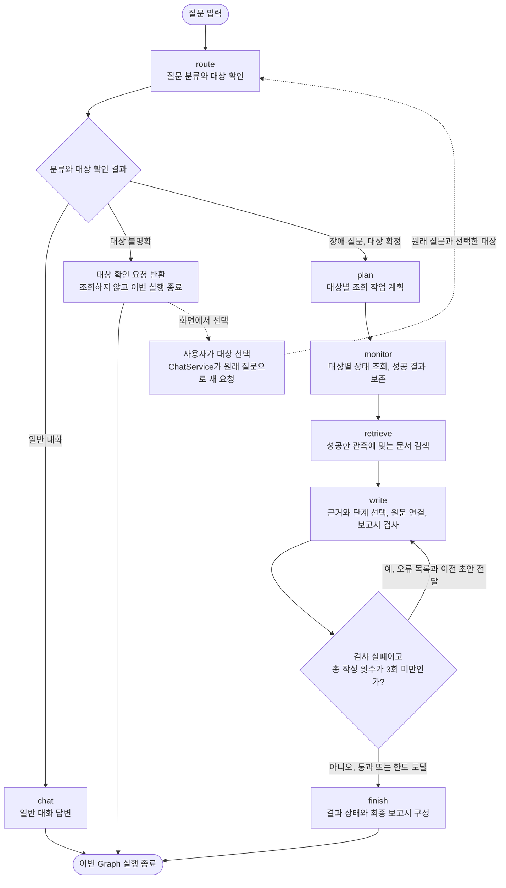
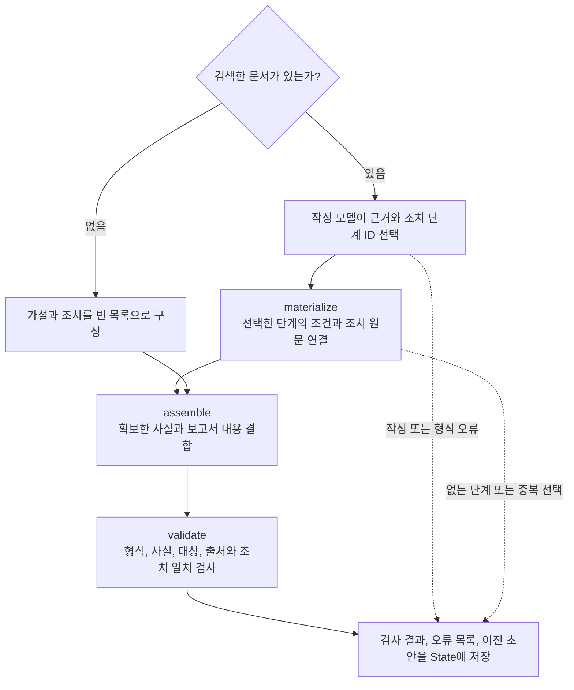

# 기능과 처리 흐름

## 주요 기능

| 기능 | 구현 내용과 코드 | 현재 검증 |
|---|---|---|
| 1. 의미 기반 런북 검색 | `retrieval/index.py`, `applicability.py`, `mcp_server.py`: 관측 조건에 맞는 문서를 임베딩과 코사인 유사도로 검색 | 인덱스 불일치, 정상 상태, 적용 조건 테스트와 동일 30문항 검색 비교 |
| 2. 근거 연결 보고서 | `agent/reporting.py`, `action_catalog.py`: 관측 사실, 점검 가설, 원문 조치, 한계, 출처 구분 | 사실 변조, 빈 알림, 공통 원인 단정 방지, 원문 단계 검사 |
| 3. 사실 검증과 재작성 | `validation.py`, `graph.py`: 사실, 대상, 출처, 조치 조건 대조. 총 3회 상한 | 오류 피드백, 이전 초안 유지, 재작성 상한, 미통과 초안 비노출 테스트 |
| 4. 진행 상태와 근거 화면 | `web_chat.html`, `service.py`: SSE 진행, 대상별 결과, 문서 원문, 검증 결과 | POST/SSE 결과 일치, 재연결 재사용, 입력 오류, 실제 날짜 질문 화면 |
| 5. 전후 평가 | 별도 평가 실행기: 입력, 관측, 문서, 모델, 제한 시간을 고정하고 버전별 저장 | 원본, v4, v5의 같은 30문항 비교. 조건 검사와 코드 해시 보존 |
| 6. 조사 대상 확인 | `targets.py`, `session_store.py`: 미확정 대상 확인, 보류 질문 저장과 복원 | 조회 전 확인, 선택 재전송, 만료, 날짜와 미등록 대상 구분 테스트 |
| 7. 부분 실패 대응 | `nodes/investigation.py`: 작업별 timeout과 재시도, 성공 결과 보존 | 일부 실패, 전체 실패, 검색 실패, 취소 전파 테스트와 실모델 오류 사례 |

## 질문부터 답변까지

1. `server.py`가 API 요청을 받고 `ChatService`가 중복 실행과 대화별 충돌을 막는다.
2. `graph.route`가 일반 대화와 장애 질문을 구분한다. 대상이 모호하면 조회하지 않고 확인 질문으로 끝낸다.
3. 대상이 확정되면 시스템별 관측을 조회한다. 각 작업의 성공과 실패를 따로 보관한다.
4. 성공한 관측에 맞는 문서만 검색한다. 관련 문서가 없으면 임의의 조치를 만들지 않는다.
5. 사실은 코드로 구성하고 모델은 가설의 근거와 조치 단계 ID를 선택한다. 조치 문장과 조건은 원문에서 가져온다.
6. 검증을 통과한 결과만 보여 준다. 끝내 실패하면 확보한 사실과 한계를 안내한다.

## Graph 분기와 재작성

`agent/graph.py`의 `build_graph()`가 아래 흐름을 구성한다. 사각형의 영문 이름은 실제 노드 이름이다. 마름모와 대상 확인 상자는 코드의 분기 조건과 응답 처리를 설명한 것으로, 별도 Agent나 추가 Graph 노드가 아니다.

### 분기를 추가한 이유

| 위치 | 해결하려는 문제 | 실제 동작 |
|---|---|---|
| `route()` | 대상이 없는 질문에서 임의 서비스를 조사 | 확인 요청을 반환하고 Graph 종료, 선택 후 새 요청에서 조사 |
| `monitor()`, `retrieve()` | 한 대상의 오류로 전체 결과를 잃음 | 작업별 결과를 수집해 성공한 관측과 실패 범위를 구분 |
| `write()` | AI가 조치 조건을 바꾸거나 잘못된 근거를 인용 | 단계 ID로 원문을 연결하고 값, 대상, 출처와 조건 검사 |
| `write`의 조건부 연결 | 잘못된 초안을 그대로 공개 | 오류와 이전 초안을 전달해 처음 포함 최대 3회 작성 |
| `finish()` | 반복 실패한 초안까지 사용자에게 표시 | 검증 미통과 시 가설과 조치를 제외하고 확보한 사실과 실패 안내 반환 |

대상 확인은 실행 중인 Graph를 체크포인트에서 재개하는 방식이 아니다. `ChatService`가 SQLite에 보관한 원래 질문을 복원하고, 선택한 대상으로 새 Graph 실행을 시작한다. 일반 대화는 `chat`에서 종료하며 장애 조사 경로를 거치지 않는다.

### write 내부에서 하는 일

검증은 별도 노드가 아니라 `write()` 내부에서 실행한다. 위 점선은 예외를 잡아 실패 결과를 기록하는 경로다. `validation_attempts`는 첫 작성부터 증가하므로 최대 3회는 최초 작성과 재작성 2회를 합한 횟수다.

`finish()`는 관측이 전혀 없으면 `failed`, 관측은 있지만 검증에 실패하면 `validation_failed`로 구분한다. 검증에 통과한 경우 추가 실패나 근거 부족 안내가 있으면 `partial`, 그 외에는 `completed`다. 검증 실패 초안은 어느 경우에도 그대로 공개하지 않는다.

### 코드 위치

- [Graph와 분기](../agent/graph.py): `route`, `monitor`, `retrieve`, `write`, `finish`, `build_graph`
- [요청과 대상 선택 복원](../agent/service.py): `ChatService.start`, `ChatService.run`
- [대상별 오류 처리](../agent/nodes/investigation.py): `run_task`
- [조치 원문 연결](../agent/action_catalog.py): `catalog`, `materialize`
- [보고서 검증](../agent/validation.py): `validate`

## 원본에서 재사용한 부분

FastAPI와 Vue, LangGraph 그래프 실행, MCP stdio Tool/Resource/Prompt 연결, 모델 어댑터, SQLite, 모의 관측 데이터와 런북은 제공된 베이스를 활용했다. MCP는 이미 별도 프로세스 구조였으며 원격 HTTP MCP 서비스로 새로 배포한 것이 아니다.

추가한 핵심은 관측 기반 문서 검색, 대상 확인, 구조화 보고서, 근거 검증과 재작성, 조치 조건 보존, 부분 실패 처리, 동일 조건 평가다. v5에서는 이 구조를 유지하고 세 실행 결함을 보완했다.

## 설계 선택과 구현 범위

- 원본 문서 6개 유지: 데이터 증가 효과와 코드 개선 효과가 섞이지 않도록 했다. 대규모 문서 일반화는 미검증이다.
- 독립 분석 노드 대신 한 보고서에서 시스템별 근거를 구분한다. 공통 원인을 자동 확정하지 않는다.
- 모든 노드를 별도 파일로 나누지는 않았다. 조사 작업, 검색, 보고서, 검증, 서비스 책임을 분리했다.
- 일반 대화의 토큰 스트리밍은 제공하지 않는다. 진행 이벤트와 검증 후 최종 답변을 표시한다.
- 진행 이벤트는 노드가 끝날 때 전달된다. 병렬 작업 하나가 끝나는 즉시 실시간 막대를 갱신하는 구조는 아니다.
- 확인 대기는 SQLite에 저장하지만 전체 LangGraph 체크포인트나 완료 요청 캐시는 서버 재시작 후 복원하지 않는다.
- 실제 복구 조치, 승인 노드, 인증, 전문 서브에이전트, LLM-as-judge는 구현 범위에 포함하지 않는다.
